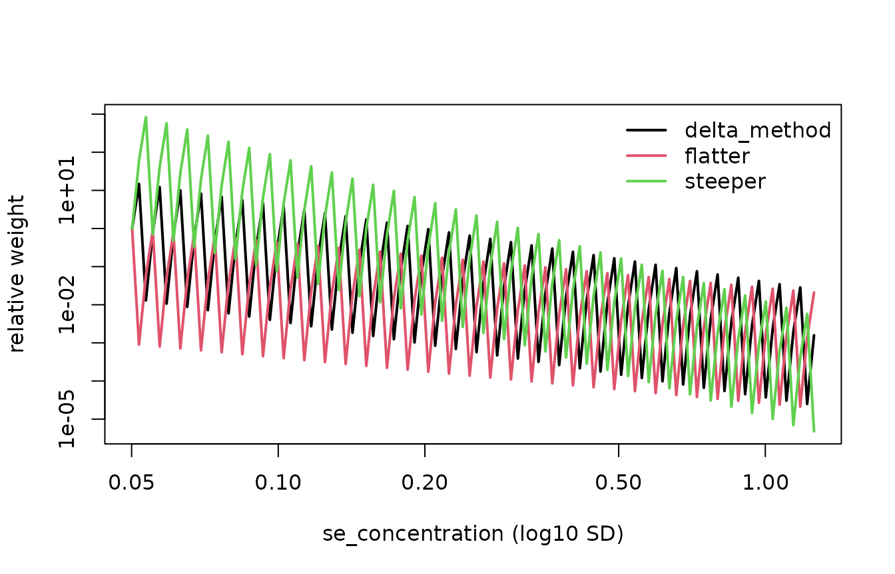

# Getting Started with curveRcore

## Ecosystem orientation

**curveRcore** is the shared foundation of the curveR suite. It defines
the data contract, preprocessing pipeline, forward models, analytical
inverses and gradients, the `calibration_result` S3 class, and the
eligibility-gating logic used identically by every fitting engine.

The three packages in the suite are:

- **curveRcore** *(this package)* — preprocessing, model functions,
  inverses, gradients, the `calibration_result` class, eligibility
  gating, detection limits, and tidy extractors.
- **curveRfreq** — frequentist NLS calibration via
  `fit_calibration_freq()` and `fit_calibration_freq_multiplate()`.
- **curveRbayes** — Bayesian calibration via Stan.

A fourth package, **curveRweights**, sits downstream of the fits: it
turns each sample’s reported precision into observation weights for
comparison analyses. This vignette introduces it, and the censoring
labels the fits produce for out-of-range samples, in the two sections
before the [Summary](#summary-section).

Both fitting engines return the same `calibration_result` object, so all
downstream code — plots, extractors, detection-limit functions — works
identically regardless of which engine produced the result.

For a complete end-to-end frequentist workflow, including the NLS
algorithm, multi-start fitting, and sample back-calculation, see
`vignette("frequentist-quickstart", package = "curveRfreq")`. This
vignette covers the **curveRcore layer** that both engines share.

------------------------------------------------------------------------

## Installation

``` r

# From GitHub:
# devtools::install_github("immunoplex/curveRcore")

library(curveRcore)
```

------------------------------------------------------------------------

## Example datasets

curveRcore ships two synthetic multi-plate datasets that mirror the
structure expected by the fitting pipeline. Both are named lists with
the same six elements:

| Element           | Description                                           |
|-------------------|-------------------------------------------------------|
| `standards`       | Standard curve wells, one row per well.               |
| `blanks`          | Blank well measurements (4 per plate).                |
| `samples`         | Patient samples with dilution and response columns.   |
| `curve_id_lookup` | Maps integer `curve_id` to antigen / plate metadata.  |
| `response_var`    | Name of the response column (`"mfi"` or `"od"`).      |
| `indep_var`       | Name of the concentration column (`"concentration"`). |

### `bead_assay_example` — Luminex / bead-based immunoassay

Spans **two antigens** (`alpha` and `beta`) × **three replicate
plates**, giving six `curve_id` values (1–6). The `alpha` curves were
simulated with a Gompertz model; the `beta` curves with a 5PL model.

``` r

data(bead_assay_example, package = "curveRcore")
str(bead_assay_example, max.level = 1)
#> List of 6
#>  $ standards      :'data.frame': 60 obs. of  8 variables:
#>  $ blanks         :'data.frame': 24 obs. of  7 variables:
#>  $ samples        :'data.frame': 120 obs. of  13 variables:
#>  $ curve_id_lookup:'data.frame': 6 obs. of  5 variables:
#>  $ response_var   : chr "mfi"
#>  $ indep_var      : chr "concentration"
head(bead_assay_example$standards)
#>   curve_id stype sampleid well    dilution     mfi assay_response_variable
#> 1        1     S   STD_01   A1 1000.000000   109.4                     mfi
#> 2        1     S   STD_02   B1  333.333333   316.9                     mfi
#> 3        1     S   STD_03   C1  100.000000  1133.0                     mfi
#> 4        1     S   STD_04   D1   33.333333  4156.1                     mfi
#> 5        1     S   STD_05   E1   10.000000 12458.1                     mfi
#> 6        1     S   STD_06   F1    3.333333 18933.4                     mfi
#>   assay_independent_variable
#> 1              concentration
#> 2              concentration
#> 3              concentration
#> 4              concentration
#> 5              concentration
#> 6              concentration
```

### `elisa_assay_example` — ELISA / optical density

Spans **one analyte** across **six plates**. Plates 1–3 were simulated
with a 5PL model; plates 4–6 with Gompertz, reflecting realistic
between-plate shape variation. The response column is `"od"`.

``` r

data(elisa_assay_example, package = "curveRcore")
str(elisa_assay_example, max.level = 1)
#> List of 6
#>  $ standards      :'data.frame': 60 obs. of  8 variables:
#>  $ blanks         :'data.frame': 24 obs. of  7 variables:
#>  $ samples        :'data.frame': 120 obs. of  12 variables:
#>  $ curve_id_lookup:'data.frame': 6 obs. of  5 variables:
#>  $ response_var   : chr "od"
#>  $ indep_var      : chr "concentration"
```

------------------------------------------------------------------------

## The five forward models

All five canonical model functions live in curveRcore. They share a
consistent parameter naming convention across the entire suite:

| Parameter | Role                                                   |
|-----------|--------------------------------------------------------|
| `a`       | Lower asymptote (baseline response); `a < d`           |
| `b`       | Scale / steepness parameter; `b > 0`                   |
| `c`       | Inflection-point location on the x-axis                |
| `d`       | Upper asymptote (saturation response); `d > a`         |
| `g`       | Asymmetry parameter (5-parameter models only); `g > 0` |
| `x`       | Independent variable — typically log₁₀(concentration)  |

The `x` pre-transformation (e.g. log₁₀) is applied upstream by
[`preprocess_standards()`](https://immunoplex.github.io/curveRcore/reference/preprocess_standards.md);
the model functions themselves are scale-agnostic.

### `logistic4` — 4PL (symmetric sigmoid)

``` math
y = a + \frac{d - a}{1 + \exp\!\left(-\frac{x - c}{b}\right)}
```

Symmetric about its inflection point at $`(c,\,(a+d)/2)`$.

``` r

x <- seq(-3, 3, length.out = 200)
y <- logistic4(x, a = 1, b = 0.5, c = 0, d = 4)
plot(x, y, type = "l", ylab = "Response", main = "logistic4")
```


### `logistic5` — 5PL (asymmetric sigmoid)

``` math
y = a + \frac{d - a}{\bigl(1 + \exp\bigl(-\frac{x-c}{b}\bigr)\bigr)^g}
```

Reduces to `logistic4` when $`g = 1`$. Values $`g > 1`$ skew toward the
upper asymptote; $`0 < g < 1`$ skew toward the lower asymptote.

### `gompertz4` — Gompertz (intrinsically asymmetric)

``` math
y = a + (d - a)\,\exp\!\bigl(-\exp(-b\,(x - c))\bigr)
```

Asymmetric without requiring a fifth parameter — skewed toward the upper
asymptote. Often the best fit for Luminex data.

### `loglogistic4` and `loglogistic5`

Classical Hill-equation parameterisations requiring $`x > 0`$ (i.e.
concentration on the natural scale, not log₁₀-transformed). When
`is_log_independent = TRUE`, `loglogistic4` is algebraically equivalent
to `logistic4` and is silently dropped by the fitting engines to avoid
redundancy.

``` r

# List all recognised model names
available_models()
#> [1] "logistic4"    "loglogistic4" "gompertz4"    "logistic5"    "loglogistic5"
```

------------------------------------------------------------------------

## Preprocessing with `preprocess_standards()`

**Neither curveRfreq nor curveRbayes preprocess data.** All transforms
must be applied upstream via
[`curveRcore::preprocess_standards()`](https://immunoplex.github.io/curveRcore/reference/preprocess_standards.md).
This clean separation ensures both fitting engines receive data on an
identical scale, making their results directly comparable.

[`preprocess_standards()`](https://immunoplex.github.io/curveRcore/reference/preprocess_standards.md)
applies four steps in order:

1.  **[`compute_concentration()`](https://immunoplex.github.io/curveRcore/reference/compute_concentration.md)**
    — converts the `dilution` column to absolute concentration using the
    undiluted standard concentration; optionally log₁₀-transforms the
    result.
2.  **[`correct_prozone()`](https://immunoplex.github.io/curveRcore/reference/correct_prozone.md)**
    — dampens the hook effect at high concentrations by compressing
    post-peak signal toward the peak.
3.  **[`perform_blank_operation()`](https://immunoplex.github.io/curveRcore/reference/perform_blank_operation.md)**
    — applies one of five blank strategies: `"ignored"` (default),
    `"included"` (append geometric mean as an extra point),
    `"subtracted"`, `"subtracted_3x"`, or `"subtracted_10x"`.
4.  **[`compute_log_response()`](https://immunoplex.github.io/curveRcore/reference/compute_log_response.md)**
    — applies [`log10()`](https://rdrr.io/r/base/Log.html) to the
    response. Values ≤ 0 are floored to 1 % of the minimum positive
    value *among the included points* before transformation.

> **Key contract:** After
> [`preprocess_standards()`](https://immunoplex.github.io/curveRcore/reference/preprocess_standards.md),
> the column named by `independent_variable` holds log₁₀ concentration
> and the response column holds log₁₀ response. These are the scales the
> fitting engines expect.

``` r

std_raw   <- bead_assay_example$standards
blank_raw <- bead_assay_example$blanks

# Preprocess one curve at a time, then stack
std_preprocessed <- do.call(rbind, lapply(
  split(std_raw, std_raw$curve_id),
  function(df) {
    cid              <- df$curve_id[1]
    blanks_for_curve <- blank_raw[blank_raw$curve_id == cid, ]
    result <- preprocess_standards(
      data                 = df,
      antigen_settings     = list(standard_curve_concentration = 30),
      response_variable    = "mfi",
      independent_variable = "concentration",
      is_log_response      = TRUE,
      blank_data           = blanks_for_curve,
      blank_option         = "subtracted",
      is_log_independent   = TRUE,
      apply_prozone        = TRUE
    )
    result$data
  }
))

# Both columns are now on the log10 scale
head(std_preprocessed[, c("curve_id", "concentration", "mfi")])
#>     curve_id concentration      mfi
#> 1.1        1   -1.52287875 1.964654
#> 1.2        1   -1.04575749 2.476663
#> 1.3        1   -0.52287875 3.047580
#> 1.4        1   -0.04575749 3.616883
#> 1.5        1    0.47712125 4.094851
#> 1.6        1    0.95424251 4.276834
```

### Mask-aware preprocessing

[`preprocess_standards()`](https://immunoplex.github.io/curveRcore/reference/preprocess_standards.md)
understands an optional `include_col` (default `"included"`): a logical
column marking which rows entered the fit (`TRUE`) versus which were
masked out (`FALSE`). The rule is simple and strict:

> **Statistics from the included points; transforms applied to every
> row.** The prozone peak, the blank geometric mean, the adaptive log
> floor, and the minimum-concentration anchor are all computed from the
> *included* rows only. The resulting transforms are then applied to
> *all* rows, so masked points land on exactly the same axes as the
> fitted points without ever influencing them.

Masked rows are never dropped — they are transformed and returned so
that downstream code (e.g. an app overlaying the observed points on the
fitted curve) can plot them on the same axes and colour them by status.
If the column is absent, every row is treated as included and the output
is identical to the column-free behaviour. Fitting engines are expected
to receive only the included subset:

``` r

pp   <- preprocess_standards(std_with_included, antigen_settings = list(...),
                             response_variable = "mfi",
                             independent_variable = "concentration",
                             is_log_response = TRUE, include_col = "included")
# Feed the fitter the included rows only — the fit is identical to one that
# never saw the masked rows:
fit_input <- pp$data[pp$data$included, ]
```

### The return shape

[`preprocess_standards()`](https://immunoplex.github.io/curveRcore/reference/preprocess_standards.md)
returns a named list:

| Element | Contents |
|----|----|
| `data` | All standard rows, transformed, carrying `included`, the log₁₀ `concentration`, the model-space response, and a pristine `assay_response_raw`. |
| `blanks` | All blank rows, transformed onto the *standards’* response floor, with `included` and `assay_response_raw`; `NULL` when no blanks were supplied. |
| `antigen_fit_options` | Record of the options used (`is_log_response`, `blank_option`, `is_log_concentration`, `apply_prozone`). |
| `derived_stats` | The set-level statistics computed from the included points: `blank_geomean`, `prozone_peak_response`, `prozone_logc_at_peak`, `response_floor`, `min_included_concentration`. |

The two frames and the raw/model-space response columns are exactly what
the batch worker persists into the `calib_standards` / `calib_blanks`
tables (one row per observed well, tagged with `included` and an
`exclusion_reason`), so a consumer can reconstruct the observed curve
with perfect fidelity without re-deriving any transform.

Note that **blanks are never subtracted automatically**. Under the
default `blank_option = "ignored"` the standard responses are left as-is
and the returned blanks are transformed for display only. Only the
explicit `"subtracted"`, `"subtracted_3x"`, and `"subtracted_10x"`
options subtract the included-blank geometric mean from the standards;
`"included"` adds it as an extra low-concentration point.

### Adaptive constraint profile

[`adaptive_constraint_profile()`](https://immunoplex.github.io/curveRcore/reference/adaptive_constraint_profile.md)
is called internally before fitting to classify the assay signal into
one of three scale classes and derive appropriate parameter bounds for
the NLS or prior specification:

| Scale class | Criterion (log₁₀ response) | Typical assay        |
|-------------|----------------------------|----------------------|
| `"high"`    | max \> 2.5                 | Luminex / bead-based |
| `"medium"`  | max \> 0.5                 | Mid-range ELISA      |
| `"low"`     | max ≤ 0.5                  | Absorbance / OD      |

The scale class drives bound widths for `b` (slope) and `g` (asymmetry),
and how far beyond the data range the inflection point `c` is allowed to
roam. Calling this function directly is not usually necessary, but it is
exported for custom constraint workflows.

------------------------------------------------------------------------

## The `calibration_result` object

Every fitting function in the curveR suite returns a single S3 object of
class `calibration_result`. The structure is defined here in curveRcore;
the fitting engines populate it.

``` r

# After fitting (e.g. via curveRfreq):
print(cr)    # concise summary
summary(cr)  # model selection table + best-model parameters
```

The object is a named list with six top-level components:

    cr
    ├── $meta
    ├── $ensemble
    ├── $selection
    ├── $grid
    ├── $samples
    └── $detection_limits

------------------------------------------------------------------------

### `$meta` — Provenance and fit configuration

`$meta` is a named list that records everything needed to reproduce or
audit the fit. It is populated at construction time and never modified
afterwards.

| Field | Type | Description |
|----|----|----|
| `method` | character | `"frequentist"` or `"bayesian"` |
| `package` | character | Fitting package that produced the result |
| `version` | character | Package version string |
| `curve_id` | character | Unique identifier for this plate/antigen combination |
| `response_var` | character | Column used as the assay response |
| `independent_var` | character | Column used as the independent variable |
| `is_log_response` | logical | Whether the response was log₁₀-transformed before fitting |
| `is_log_independent` | logical | Whether concentration was log₁₀-transformed before fitting |
| `timestamp` | POSIXct | When the object was created |

Additional fields such as `antigen`, `plate`, `n_standards`,
`n_samples`, and `pcov_threshold` may be present depending on the
calling package.

``` r

cr$meta$method           # "frequentist"
cr$meta$curve_id         # e.g. "plate1_antigen_A"
cr$meta$is_log_response  # TRUE
```

------------------------------------------------------------------------

### `$ensemble` — All models that were attempted

`$ensemble` is a named list with one entry per model that was fitted,
keyed by model name (e.g. `"logistic4"`, `"gompertz4"`). Even models
that failed to converge have an entry, which is important for diagnosing
why a preferred model was not selected.

Each entry contains:

| Field | Type | Description |
|----|----|----|
| `model_name` | character | One of the five canonical model names |
| `converged` | logical | Whether the optimizer reached a solution |
| `parameters` | data frame | Parameter estimates with uncertainty (see below) |
| `fit_stats` | named list | Goodness-of-fit statistics |
| `eligibility` | named list | Output of [`assess_model_eligibility()`](https://immunoplex.github.io/curveRcore/reference/assess_model_eligibility.md) for this model |
| `grid` | data frame | Per-model precision profile (populated for every converged model) |
| `raw_fit` | object | The raw fit object from `nlsLM()` or Stan (optional) |

The `parameters` data frame columns differ slightly by framework:

| Framework   | Columns                                                 |
|-------------|---------------------------------------------------------|
| Frequentist | `term`, `estimate`, `std_error`, `statistic`, `p.value` |
| Bayesian    | `term`, `mean`, `sd`, `q2.5`, `q50`, `q97.5`            |

The `fit_stats` list contains `aic`, `bic`, `rmse`, `r_squared`, and
`n_obs` for frequentist fits, and `loo_elpd`, `loo_se`, `waic` for
Bayesian fits.

> **Design note:** Precision grids are computed for *every converged
> model*, not just the selected one. This means `ensemble[[model]]$grid`
> is available for the runner-up and can be inspected directly (see
> Section 6 below). The top-level `$grid` is simply a pointer to the
> best-model’s grid — no recomputation occurs.

``` r

# Check convergence across all models
sapply(cr$ensemble, `[[`, "converged")

# Inspect a specific model
cr$ensemble[["logistic4"]]$converged
cr$ensemble[["logistic4"]]$parameters
cr$ensemble[["logistic4"]]$fit_stats
```

------------------------------------------------------------------------

### `$selection` — Best model choice and eligibility record

`$selection` records the outcome of the two-stage selection process:
eligibility gating followed by information-criterion ranking. It
provides full transparency about which models were considered and why
the winner was chosen.

| Field | Type | Description |
|----|----|----|
| `best_model_name` | character | Name of the selected model, or `NA` if none converged |
| `criterion` | character | Selection criterion used, e.g. `"AIC+eligibility"` |
| `fallback` | logical | `TRUE` if no model passed all eligibility gates |
| `fallback_reason` | character | Human-readable explanation of any gate failures |
| `eligible_models` | character vector | Names of all models that passed eligibility gating |
| `assessments` | named list | Full [`assess_model_eligibility()`](https://immunoplex.github.io/curveRcore/reference/assess_model_eligibility.md) output for every model |
| `weights` | data frame | AIC (or LOO) comparison table across all models |
| `aic_best` | character | Model that would have won by AIC alone (ignoring gates) |

When `aic_best != best_model_name`, the AIC winner was demoted by a gate
failure — a useful diagnostic for problem plates.

``` r

cr$selection$best_model_name   # "gompertz4"
cr$selection$criterion         # "AIC+eligibility"
cr$selection$fallback          # FALSE
cr$selection$eligible_models   # c("gompertz4", "logistic4")
cr$selection$aic_best          # may differ from best_model_name
```

------------------------------------------------------------------------

### `$grid` — Precision profile of the best model

`$grid` is a data frame of evenly-spaced predictions from the selected
best model across the full fitted concentration range (default 200
points, configurable via `n_grid`). It is the primary input for plotting
the calibration curve and for computing quantification limits.

| Column | Description |
|----|----|
| `log10_concentration` | Concentration on the log₁₀ scale (x-axis) |
| `concentration` | Concentration on the natural scale |
| `x_fit` | The value passed to the model (equals `log10_concentration` when `is_log_independent = TRUE`) |
| `predicted_response` | Forward model prediction at each grid point (on the fitting scale) |
| `ci_lower`, `ci_upper` | Delta-method 95 % CI on the response scale |
| `predicted_concentration` | Back-calculated concentration from the predicted response |
| `se_concentration` | Delta-method SD of back-calculated log₁₀ concentration (uncapped) |
| `pcov` | Percent CV derived from `se_concentration`, capped at `cv_x_max` |
| `pcov_rmse` | Relative RMSE (%) — includes bias of `predicted_concentration` vs `x_fit` |
| `pcov_pass` | Logical; whether `pcov` is below the acceptance threshold |
| `d2y_dx2` | Second derivative of log₁₀ response w.r.t. log₁₀ concentration (curvature) |

The relationship between `se_concentration` and `pcov` is:

``` math
\text{pcov} = \text{se\_concentration} \times \ln(10) \times 100
```

`se_concentration` is the uncapped, modelling-scale quantity and is what
downstream variance/weighting models (e.g. `curveRweights`) should
consume. `pcov` is censored at `cv_x_max` and is intended for
human-readable QC only.

Use
[`pcov_from_se()`](https://immunoplex.github.io/curveRcore/reference/pcov_se_conversion.md)
and
[`se_from_pcov()`](https://immunoplex.github.io/curveRcore/reference/pcov_se_conversion.md)
— the single canonical implementation of this conversion — rather than
reimplementing it:

``` r

# Convert a vector of se_concentration values to pcov
se_vals  <- c(0.05, 0.08, 0.15)
pcov_from_se(se_vals)    # → percent CV values
#> [1] 11.51293 18.42068 34.53878

# And back
se_from_pcov(pcov_from_se(se_vals))   # round-trips exactly
#> [1] 0.05 0.08 0.15
```

``` r

head(cr$grid)
tidy_grid(cr)   # same, with curve_id column attached
```

------------------------------------------------------------------------

### `$samples` — Back-calculated concentrations for test samples

`$samples` is `NULL` if no test samples were supplied to the fitting
function. When samples are present it is a data frame with one row per
sample replicate:

| Column | Description |
|----|----|
| `sampleid` | Sample identifier (carried through from input) |
| `curve_id` | Plate/antigen identifier |
| `raw_assay_response` | Original response value before any transform |
| `observed_response_fit` | Response on the fitting scale |
| `predicted_log10_concentration` | Back-calculated concentration on the log₁₀ scale |
| `predicted_concentration` | Same as above when `is_log_independent = TRUE` |
| `final_concentration` | Dilution-corrected concentration: `10^predicted_log10_concentration × dilution` |
| `se_concentration` | SD of `predicted_log10_concentration` (delta method, or posterior SD) |
| `pcov` | Percent CV of the back-calculated concentration, capped at `cv_x_max` |
| `pcov_pass` | Logical; whether precision meets the acceptance threshold |
| `conc_q_lo`, `conc_q_med`, `conc_q_hi` | 2.5 / 50 / 97.5 % predictive quantiles of the concentration, natural scale, dilution-corrected |
| `p_below_lloq`, `p_above_uloq` | Probability the concentration is below the LLOQ / above the ULOQ |
| `p_below_cutoff` | Probability the dilution-corrected concentration is below `decision_cutoff` (`NA` if none) |
| `frac_draws_below_a`, `frac_draws_above_d` | Share of draws whose response lay beyond the low / high asymptote |

See [Out-of-range samples](#out-of-range-samples) for how these are
computed and for the censoring columns added by
[`classify_censoring_multiplate()`](https://immunoplex.github.io/curveRcore/reference/classify_censoring_multiplate.md).
The [Censoring](#censoring) section below works through the classes and
the analysis options.

Any additional columns present in the original sample data (dilution,
replicate number, patient ID, etc.) are carried through unchanged.

``` r

cr$samples[, c("sampleid", "final_concentration", "pcov", "pcov_pass")]
tidy_samples(cr)   # same, with curve_id column attached
```

------------------------------------------------------------------------

### `$detection_limits` — LODs, MDC, and RDL

`$detection_limits` is `NULL` by default and is populated by calling
[`compute_detection_limits()`](https://immunoplex.github.io/curveRcore/reference/compute_detection_limits.md),
either automatically inside the fitting pipeline or post-hoc:

``` r

cr <- compute_detection_limits(cr)
```

The list has two sub-lists.

**`$lods`** — derived from the confidence interval on the lower
asymptote `a` and upper asymptote `d`:

| Field | Description |
|----|----|
| `lower_lod_response` | Upper 97.5 % CI of `a`; response threshold defining the lower LOD |
| `upper_lod_response` | Lower 2.5 % CI of `d`; response threshold defining the upper LOD |
| `lower_lod_log10_conc` | Lower LOD mapped to log₁₀ concentration |
| `upper_lod_log10_conc` | Upper LOD mapped to log₁₀ concentration |
| `lower_lod_conc` | Lower LOD on the natural concentration scale |
| `upper_lod_conc` | Upper LOD on the natural concentration scale |

**`$mdc_rdl`** — minimum detectable concentration and reliable detection
limit, derived by inverting CI-modified versions of the fitted curve:

| Field | Description |
|----|----|
| `mdc_lower_log10` / `mdc_lower_conc` | Lower MDC (log₁₀ and natural units) |
| `mdc_upper_log10` / `mdc_upper_conc` | Upper MDC |
| `rdl_lower_log10` / `rdl_lower_conc` | Lower RDL (conservative: compressed `d`) |
| `rdl_upper_log10` / `rdl_upper_conc` | Upper RDL (liberal: expanded `d`) |

``` r

cr$detection_limits$lods$lower_lod_conc
cr$detection_limits$lods$upper_lod_conc
cr$detection_limits$mdc_rdl$rdl_lower_conc
```

For multiplate results, use the convenience wrapper:

``` r

mp <- compute_detection_limits_multiplate(mp)
```

------------------------------------------------------------------------

### Out-of-range samples: censoring, intervals and threshold probabilities

`pcov` summarises a sample’s uncertainty as one symmetric number on the
log₁₀ scale. That cannot distinguish a sample **below** the LLOQ — whose
true concentration is bounded between 0 and roughly the LLOQ — from one
**above** the ULOQ, which has no upper bound. Two pieces of output carry
that missing information.

**Censoring.**
[`classify_censoring_multiplate()`](https://immunoplex.github.io/curveRcore/reference/classify_censoring_multiplate.md)
(run after
[`compute_detection_limits_multiplate()`](https://immunoplex.github.io/curveRcore/reference/compute_detection_limits_multiplate.md)
and
[`classify_pcov_gates_multiplate()`](https://immunoplex.github.io/curveRcore/reference/classify_pcov_gates_multiplate.md))
adds:

| Column | Description |
|----|----|
| `censor_class` | `quantified`, `lod_to_lloq`, `below_lod`, `below_lloq` (no LOD available), `above_uloq`, `saturated` (response at/above the upper LOD), `no_response` |
| `censor_type` | `none`, `left`, `interval`, `right` — the codes censored-data methods expect |
| `censor_lower`, `censor_upper` | Bounds on the natural, dilution-corrected scale; `NA` = unbounded |

The response scale is checked first, so a sample whose response lies
beyond an asymptote — and therefore has no finite point estimate — is
still assigned the right side.

**Predictive draws.** Each engine back-calculates every sample many
times (Bayesian: once per posterior draw; frequentist: once per Monte
Carlo draw from the fitted parameter distribution plus residual noise).
A draw whose response falls beyond that draw’s asymptote is kept as
censored (`-Inf` / `+Inf` on the log₁₀ scale, via
[`invert_with_bounds()`](https://immunoplex.github.io/curveRcore/reference/invert_with_bounds.md))
rather than dropped, and
[`summarize_conc_draws()`](https://immunoplex.github.io/curveRcore/reference/summarize_conc_draws.md)
turns the draws into the quantile and probability columns in the table
above. Because the quantiles are computed on the log scale and
back-transformed, the interval is asymmetric on the natural scale, and a
below-range sample typically gets a tight upper bound and a lower bound
of 0.

``` r

mp <- classify_censoring_multiplate(mp)
s  <- tidy_samples(mp)
s[s$censor_class != "quantified",
  c("sampleid", "censor_class", "censor_upper", "conc_q_hi", "p_below_lloq")]
```

`se_concentration` and `pcov` are unchanged by this — they are still
computed from the invertible draws only. `frac_draws_below_a` /
`frac_draws_above_d` show how many draws those legacy summaries leave
out.

------------------------------------------------------------------------

## Eligibility gating

### Why gates come before AIC

AIC and LOO-CV measure forward-fit quality — how well the model predicts
the response values in the training data. They are completely blind to
whether the fitted model can **back-calculate concentration** reliably.
A model whose asymptote estimate is sitting on a constraint boundary, or
whose covariance matrix is nearly singular, can have a lower AIC than a
well-identified competitor purely by overfitting.

The eligibility gates intercept such models before AIC ranking. Only
models that pass all applicable gates enter the ranking.

### The four gates

All gates are evaluated by
[`assess_model_eligibility()`](https://immunoplex.github.io/curveRcore/reference/assess_model_eligibility.md):

#### Gate 1 — `at_bound` *(frequentist only)*

Checks that no parameter estimate lies within `bound_tol` (default
`1e-4`) of its lower or upper constraint bound. A boundary solution
means the optimiser could not find an interior minimum — AIC asymptotics
do not hold at the boundary.

#### Gate 2 — `vcov_condition` *(frequentist only)*

Computes the condition number κ of `vcov(fit)`. If κ ≥ 1×10⁸, the
covariance matrix is near-singular, making standard error propagation
unreliable.

#### Gate 3 — `rel_se` *(both frameworks)*

Checks that `SE / |estimate| < max_rel_se` (default 5.0) for every free
parameter. A relative SE larger than the estimate itself indicates an
unidentified parameter.

#### Gate 4 — `dynamic_range` *(requires the precision grid)*

Locates the LLOQ and ULOQ — where `pcov` crosses `pcov_threshold`
(default 20 %) — and requires `ULOQ − LLOQ ≥ min_dynamic_range_log10`
(default 0.5 log₁₀ units, approximately 3-fold).

### Selection logic

After assessment,
[`select_best_eligible()`](https://immunoplex.github.io/curveRcore/reference/select_best_eligible.md)
implements the following decision tree:

    eligible_models ← {models that passed all gates}

    if length(eligible_models) > 0:
        best ← eligible_models ranked by AIC (lowest) or LOO elpd (highest)
        fallback ← FALSE

    else:                                        # fallback path
        best ← model with widest dynamic_range_log10;
                ties broken by AIC / LOO
        fallback ← TRUE
        fallback_reason ← per-model gate failure summary

The fallback ensures a result is always returned. When `fallback = TRUE`
the selection is a best-effort choice and should be treated with
caution.

### Reading the gate results

Each model’s eligibility report is stored in
`ensemble[[model]]$eligibility`. The `$gates` data frame has columns
`gate`, `passed`, and `detail`:

``` r

for (nm in names(cr$ensemble)) {
  elig <- cr$ensemble[[nm]]$eligibility
  cat(sprintf("\n── %s  (eligible = %s) ──\n", nm, elig$eligible))
  print(elig$gates)
  cat(sprintf(
    "   LLOQ = %.3f  ULOQ = %.3f  DR = %.3f log10\n",
    elig$lloq, elig$uloq, elig$dynamic_range_log10
  ))
}
```

    ── gompertz4  (eligible = TRUE) ──
            gate passed detail
    1   at_bound   TRUE
    2 vcov_condition TRUE
    3     rel_se   TRUE
    4 dynamic_range  TRUE  dynamic range = 2.87 log10
       LLOQ = -2.341  ULOQ = 0.531  DR = 2.872 log10

    ── logistic4  (eligible = FALSE) ──
            gate passed              detail
    1   at_bound  FALSE  b at lower bound
    2 vcov_condition  TRUE
    3     rel_se   TRUE
    4 dynamic_range  TRUE  dynamic range = 1.94 log10
       LLOQ = -1.982  ULOQ = -0.041  DR = 1.941 log10

------------------------------------------------------------------------

## Per-model precision grids and LOQs

### The `d2y_dx2` column and shape-LOQ

Every precision grid includes a `d2y_dx2` column: the second derivative
$`d^2(\log_{10} y) / d(\log_{10} x)^2`$ computed from the grid points
with zero additional model evaluations via
[`enrich_grid_with_d2y()`](https://immunoplex.github.io/curveRcore/reference/enrich_grid_with_d2y.md).

For a monotone increasing sigmoid this derivative has a peak below the
inflection point, a zero crossing at the inflection point, and a valley
above it. The **shape-LLOQ** (peak) and **shape-ULOQ** (valley) bracket
the quasi-linear region of maximum assay sensitivity.

Shape-LOQs are stored in `ensemble[[model]]$eligibility` as
`shape_lloq_log10` and `shape_uloq_log10` (plus natural-scale and
response-scale counterparts), computed by
[`compute_shape_loq_from_grid()`](https://immunoplex.github.io/curveRcore/reference/compute_shape_loq_from_grid.md).

### Comparing shape-LOQ with pcov-LOQ

The two LOQ families complement each other:

- The **pcov-LOQ** (`elig$lloq`, `elig$uloq`) is precision-based: it
  identifies the concentration range where back-calculation %CV stays
  below `pcov_threshold`. It incorporates parameter uncertainty and
  observation noise.
- The **shape-LOQ** is purely geometric: it marks where the curve
  changes curvature most rapidly, independent of measurement
  uncertainty. It typically gives a tighter (narrower) range.

``` r

best_nm  <- cr$selection$best_model_name
elig     <- cr$ensemble[[best_nm]]$eligibility

data.frame(
  Metric     = c("Shape-LLOQ", "Shape-ULOQ", "pcov-LLOQ", "pcov-ULOQ"),
  log10_conc = c(elig$shape_lloq_log10, elig$shape_uloq_log10,
                 elig$lloq, elig$uloq),
  conc       = 10^c(elig$shape_lloq_log10, elig$shape_uloq_log10,
                    elig$lloq, elig$uloq)
)
```

------------------------------------------------------------------------

## Tidy extractors

The canonical way for downstream packages and user code to access
predictions is through the tidy extractor functions. Do not reach into
the object internals directly — the extractors dispatch automatically to
both the single-plate and multiplate classes.

### `tidy_samples()` — sample predictions

``` r

# Single plate
s <- tidy_samples(cr)

# Multiplate: row-binds all plates with curve_id attached
s_all <- tidy_samples(mp)
head(s_all[, c("curve_id", "sampleid", "final_concentration",
               "se_concentration", "pcov", "pcov_pass")])
```

### `tidy_grid()` — precision profiles

``` r

# Best-model grid for a single plate
g <- tidy_grid(cr)

# Multiplate: all grids row-bound with curve_id
g_all <- tidy_grid(mp)

# Inspect a non-selected model's grid:
g_runner_up <- tidy_grid(cr, model = "logistic4")
```

------------------------------------------------------------------------

## Multi-plate objects

When multiple plates are fitted together the result is a
`calibration_result_multiplate` object — a named list with `$meta` and
`$plates`, where each element is a complete single-plate
`calibration_result`.

``` r

mp$plates[["1"]]   # a full calibration_result for curve_id 1

# Global metadata
mp$meta$method
mp$meta$n_curves

# Tidy extractors work identically
tidy_samples(mp)
tidy_grid(mp)
compute_detection_limits_multiplate(mp)
```

------------------------------------------------------------------------

## Cross-method comparison

When the same data has been fitted by both curveRfreq and curveRbayes,
three comparison utilities are available:

``` r

# Merge prediction grids (columns prefixed by method name)
compare_calibrations(cr_freq, cr_bayes)

# Side-by-side parameter table with relative differences
compare_parameters(cr_freq, cr_bayes)

# Paired sample predictions with agreement columns
comp <- compare_samples(cr_freq, cr_bayes)
head(comp[, c("sampleid",
              "frequentist_final_concentration",
              "bayesian_final_concentration",
              "conc_diff")])

# Agreement metrics (bias, MAE, RMSE, Pearson r, Lin's CCC)
agreement_metrics(
  cr_freq$samples$predicted_log10_concentration,
  cr_bayes$samples$predicted_log10_concentration
)
```

## Censoring: samples outside the quantifiable range

A back-calculated concentration is only as informative as the part of
the curve it lands on. A response near the lower asymptote says “the
concentration is small”, not *how* small; a response near the upper
asymptote says “large”, with no upper bound. Treating those samples as
ordinary numbers — or discarding them — biases every downstream summary,
because *which* samples fall out of range depends on the thing you are
trying to estimate. curveRcore therefore labels each sample with a
**censoring class** and the **bounds** that class implies, so that
censored-data methods can use the samples for what they do know.

### Classes and bounds

[`classify_censoring()`](https://immunoplex.github.io/curveRcore/reference/classify_censoring.md)
works from the response scale first, so a sample whose response lies
beyond an asymptote — and which therefore has no finite point estimate —
is still placed on the correct side.

| `censor_class` | Meaning | `censor_type` | Bounds (natural, dilution-corrected) |
|----|----|----|----|
| `quantified` | Between the LLOQ and ULOQ | `none` | — (use `final_concentration`) |
| `lod_to_lloq` | Above the lower LOD, below the LLOQ | `interval` | `[LOD, LLOQ] × dilution` |
| `below_lod` | Response below the lower-LOD response | `left` | `[0, LOD] × dilution` |
| `below_lloq` | Below the LLOQ and no LOD available | `left` | `[0, LLOQ] × dilution` |
| `above_uloq` | Above the ULOQ | `right` | `(ULOQ, ∞) × dilution` |
| `saturated` | Response at or above the upper-LOD response | `right` | `(ULOQ, ∞) × dilution` |
| `no_response` | No usable response | `NA` | — |

`censor_type` uses the codes that survival-analysis and
censored-regression software expect, and `censor_lower` / `censor_upper`
hold the bounds with `NA` meaning unbounded. The single-curve function
is useful for seeing the rules at work; in a pipeline you call
[`classify_censoring_multiplate()`](https://immunoplex.github.io/curveRcore/reference/classify_censoring_multiplate.md)
on a fitted result instead.

``` r

# Illustrative numbers: a curve with asymptotes a = 1, d = 4 on the fitting
# (log10 response) scale, LLOQ = 10^0.5 and ULOQ = 10^3 before dilution.
smp <- data.frame(
  label    = c("high", "mid", "just under LLOQ", "near the floor", "at the floor", "saturated"),
  response = c(3.7, 2.4, 1.55, 1.25, 1.02, 3.995),
  x_log10  = c(2.9, 1.5, 0.35, NA, NA, NA)
)
cc <- classify_censoring(
  response = smp$response, x_log10 = smp$x_log10, dilution = 100,
  lloq_log10 = 0.5, uloq_log10 = 3,
  lod_response = 1.3, ulod_response = 3.8,
  lod_log10 = 0.0, ulod_log10 = 3.4,
  a = 1, d = 4
)
cbind(smp[, c("label", "response")], cc)
#>             label response censor_class censor_type censor_lower censor_upper
#> 1            high    3.700   quantified        none           NA           NA
#> 2             mid    2.400   quantified        none           NA           NA
#> 3 just under LLOQ    1.550  lod_to_lloq    interval        1e+02     316.2278
#> 4  near the floor    1.250    below_lod        left           NA     100.0000
#> 5    at the floor    1.020    below_lod        left           NA     100.0000
#> 6       saturated    3.995    saturated       right        1e+05           NA
```

The samples with no `x_log10` have no finite estimate at all, yet each
is placed on the correct side of the range.

### Intervals and threshold probabilities

Bounds say where a censored sample *must* lie; they do not say where it
*most likely* lies inside that region, and for a quantified sample the
symmetric `pcov` ignores that uncertainty is wider on one side. Both
fitting engines therefore back-calculate every sample many times — once
per posterior draw (curveRbayes) or per Monte Carlo draw of the fitted
parameters plus residual noise (curveRfreq). A draw whose response falls
beyond *that draw’s* asymptote is kept as `-Inf` (concentration 0) or
`+Inf` (unbounded) rather than dropped, and
[`summarize_conc_draws()`](https://immunoplex.github.io/curveRcore/reference/summarize_conc_draws.md)
turns the draw matrix into the interval and probability columns of
`$samples`:

``` r

set.seed(1)
n_draw <- 2000
# rows = samples, columns = draws; pre-dilution log10 concentration
x <- rbind(
  well_inside  = rnorm(n_draw, 1.5, 0.10),                              # comfortably quantified
  near_floor   = rnorm(n_draw, 0.2, 0.60),                              # straddles the LLOQ
  at_floor     = c(rep(-Inf, 1400), rnorm(n_draw - 1400, 0.1, 0.5)),    # 70% of draws beyond a
  near_ceiling = c(rep( Inf,  300), rnorm(n_draw -  300, 2.9, 0.3))     # 15% beyond d
)
out <- summarize_conc_draws(x, dilution = 100, lloq_log10 = 0.5, uloq_log10 = 3,
                            decision_cutoff = 50)
cbind(sample = rownames(x), round(out, 3))
#>         sample conc_q_lo conc_q_med conc_q_hi p_below_lloq p_above_uloq
#> 1  well_inside  1950.795   3136.692  5043.193        0.000        0.000
#> 2   near_floor     9.217    158.480  2532.980        0.679        0.000
#> 3     at_floor     0.000      0.000   569.844        0.944        0.000
#> 4 near_ceiling 21924.615  90287.755        NA        0.000        0.452
#>   p_below_cutoff frac_draws_below_a frac_draws_above_d
#> 1          0.000                0.0               0.00
#> 2          0.202                0.0               0.00
#> 3          0.766                0.7               0.00
#> 4          0.000                0.0               0.15
```

Read across the rows. `at_floor` gets `conc_q_lo = 0` and a bounded
upper quantile: it is almost certainly below the LLOQ (`p_below_lloq`),
and it is *informative* for a threshold question such as “below 50?”
(`p_below_cutoff`) even though its `pcov` would be capped at the
maximum. `near_ceiling` gets `conc_q_hi = NA` because more than 2.5 % of
its draws are unbounded above. `frac_draws_below_a` and
`frac_draws_above_d` report how much of each sample’s predictive
distribution the legacy `se_concentration` / `pcov` silently leave out;
those two summaries are deliberately unchanged.

### Analysing censored samples

Put the bounds on a log10 scale once, in the `Surv(type = "interval2")`
convention (`y_lo == y_hi` for an exact value, `NA` for an unbounded
side):

``` r

as_interval2 <- function(s) {
  y <- log10(s$final_concentration)
  lo <- ifelse(s$censor_type %in% c("interval", "right"), log10(s$censor_lower), NA_real_)
  hi <- ifelse(s$censor_type %in% c("left", "interval"),  log10(s$censor_upper), NA_real_)
  none <- s$censor_type %in% "none"
  lo[none] <- y[none]; hi[none] <- y[none]
  cbind(s, y_lo = lo, y_hi = hi)
}
```

The cost of ignoring the censoring is easy to see on simulated data.
Below, about a third of a group’s true values lie under the
quantification limit:

``` r

set.seed(42)
n    <- 400
true <- rnorm(n, mean = 0.6, sd = 0.7)          # log10 concentration; truth: mean 0.6
lloq <- 0.3
cens <- true < lloq
sim  <- data.frame(
  final_concentration = ifelse(cens, 10^lloq / 2, 10^true),   # LLOQ/2 stand-in when censored
  censor_type  = ifelse(cens, "left", "none"),
  censor_lower = NA_real_,
  censor_upper = ifelse(cens, 10^lloq, NA_real_)
)
sim <- as_interval2(sim)

tob <- survival::survreg(survival::Surv(y_lo, y_hi, type = "interval2") ~ 1,
                         data = sim, dist = "gaussian")
c(truth                  = 0.6,
  complete_case          = mean(log10(sim$final_concentration[!cens])),
  substitute_LLOQ_over_2 = mean(log10(sim$final_concentration)),
  censored_likelihood    = unname(coef(tob)))
#>                  truth          complete_case substitute_LLOQ_over_2 
#>              0.6000000              0.9491793              0.6403612 
#>    censored_likelihood 
#>              0.5954241
```

Dropping the censored rows overstates the mean; substitution errs by an
amount that depends on the arbitrary fraction chosen and understates the
variance. The censored-likelihood (Tobit) estimate recovers the truth.
For regression models, repeated measures, Bayesian likelihoods,
survival-style nonparametrics and threshold classification, see
`vignette("analysing-ispi-exports", package = "curveR")`.

------------------------------------------------------------------------

## Precision weights with curveRweights

Censoring deals with samples the curve cannot measure. A separate
problem affects the samples it *can* measure: their precision is not
constant. `pcov` and `se_concentration` follow a U-shaped profile along
the curve — small in the middle, large near both asymptotes — so a plain
average or regression treats a noisy sample and a sharp one as equally
trustworthy.

**curveRweights** converts that profile into **continuous observation
weights**. It does not use `1 / se^2` directly, because the delta-method
standard error is a model-based prediction and is not guaranteed to be
calibrated against the scatter you actually see between samples. Instead
it estimates, from your data, how residual variance relates to the
reported precision:

``` math
 \sigma_i = \phi \cdot s_i^{\beta_1}, \qquad w_i = 1 / \sigma_i^2 
```

where $`s_i`$ is `se_concentration` (or `pcov`) for sample *i*. The
location model is a **saturated cell-means** model (one mean per design
cell, e.g. arm × timepoint), so any structure in the means is absorbed
there and cannot leak into the scale estimate.

| Estimate | Reads as |
|----|----|
| $`\phi \approx 1`$, $`\beta_1 \approx 1`$ | The curve’s reported precision is about right |
| $`\phi > 1`$ | Extra variance beyond measurement error (biology, plate effects) |
| $`\beta_1 < 1`$ | Weights are flatter than the reported precision suggests |
| $`\beta_1 > 1`$ | Reported precision differences are amplified in the data |

``` r

# What the weight model implies, for illustrative values of (phi, beta1)
se <- 10^seq(-1.3, 0.1, length.out = 100)
prof <- sapply(list(delta_method = c(1, 1), flatter = c(1.2, 0.6), steeper = c(1.8, 1.9)),
               function(p) 1 / (p[1] * se^p[2])^2)
prof <- prof / apply(prof, 2, max)            # compare shapes on a common scale
matplot(se, prof, type = "l", lty = 1, lwd = 2, log = "xy",
        xlab = "se_concentration (log10 SD)", ylab = "relative weight")
legend("topright", legend = colnames(prof), col = 1:3, lty = 1, lwd = 2, bty = "n")
```



### The workflow

curveRweights builds on curveRcore (it imports it) and needs `brms` and
a Stan backend, so this vignette shows the calls rather than running
them. Three things matter:

1.  **Design columns ride along.** The factors that define your
    comparison cells must be columns on the `samples` you give the
    fitting function; the fitters carry them through into `$samples`.
2.  **Weights are estimated once, from the whole batch**, then reused.
3.  **Weights apply to test samples**, not to standards.

``` r

library(curveRweights)

# 1. Fit curves as usual (samples must carry timeperiod and cohort_arm)
mp <- curveRfreq::fit_calibration_freq_multiplate(
  standards = std_preprocessed, samples = samples_with_design,
  response_var = "mfi", is_log_response = TRUE, is_log_independent = TRUE
)
mp <- compute_detection_limits_multiplate(mp)
mp <- classify_pcov_gates_multiplate(mp)
mp <- classify_censoring_multiplate(mp)

# 2. Weight-input frame -> estimate (phi, beta1) -> inspect
wd <- as_weight_data(mp, design = c("timeperiod", "cohort_arm"))
pw <- fit_precision_weights(wd)
pw                                   # phi, beta1 with intervals and a plain-language regime
weight_diagnostics(pw)

# 3. Attach weights to the sample table, or evaluate them on the precision grid
samples_w <- join_weights(tidy_samples(mp), pw)
profile   <- predict_weights(pw, newdata = mp)
```

`w` is the raw inverse-variance weight and `w_norm` is rescaled so
weighted and unweighted estimates share a scale. For data that did not
come from a curveR fit, the standalone path (`prepare_cv()` →
`diagnose_cv()` → `fit_saturated_weight_batch()`) estimates the same
model; see `vignette("precision-weighting", package = "curveRweights")`.

### Weights and censoring are different tools

Weights describe how noisy a *measured* sample is; they do not say what
to do with a sample that is out of range. Inverse-variance weighting
down-weights exactly the samples whose precision is poor because their
concentration is low or high, so weighted means drift towards the middle
of the curve. Use the weights for `quantified` samples and represent
out-of-range samples by their censoring bounds (previous section). The
worked demonstration, and the way to combine the two, are in the
curveRweights vignette
`vignette("precision-weighting", package = "curveRweights")`, section
“Weights and censored samples”.

------------------------------------------------------------------------

## Summary

curveRcore provides six interconnected layers shared by all fitting
engines, and two follow-on analyses that build on them:

1.  **Datasets** — `bead_assay_example` (Luminex) and
    `elisa_assay_example` (ELISA) for testing and documentation.

2.  **Forward models** — `logistic4`, `logistic5`, `gompertz4`,
    `loglogistic4`, `loglogistic5`; consistent `a / b / c / d / g`
    parameterisation throughout.

3.  **Preprocessing** —
    [`preprocess_standards()`](https://immunoplex.github.io/curveRcore/reference/preprocess_standards.md)
    applies concentration computation, prozone correction, blank
    handling, and log₁₀ transforms in a fixed, reproducible order.

4.  **Inverses and gradients** — closed-form analytical inverses and
    delta-method gradients for all five models, used for
    back-calculation and uncertainty propagation.

5.  **Eligibility gating** —
    [`assess_model_eligibility()`](https://immunoplex.github.io/curveRcore/reference/assess_model_eligibility.md)
    and
    [`select_best_eligible()`](https://immunoplex.github.io/curveRcore/reference/select_best_eligible.md)
    intercept unidentified or boundary-constrained models before AIC /
    LOO ranking.

6.  **Result class and extractors** — `calibration_result` (single
    plate) and `calibration_result_multiplate`; tidy extractors
    [`tidy_samples()`](https://immunoplex.github.io/curveRcore/reference/tidy_samples.md)
    and
    [`tidy_grid()`](https://immunoplex.github.io/curveRcore/reference/tidy_grid.md);
    pcov / SE conversion utilities; detection-limit functions; and
    cross-method comparison helpers.

7.  **Censoring** —
    [`classify_censoring_multiplate()`](https://immunoplex.github.io/curveRcore/reference/classify_censoring_multiplate.md)
    labels samples that fall outside the quantifiable range
    (`censor_class`, `censor_type`, bounds), and
    [`summarize_conc_draws()`](https://immunoplex.github.io/curveRcore/reference/summarize_conc_draws.md)
    gives asymmetric intervals and threshold probabilities that keep
    out-of-range draws as censored.

8.  **Precision weights** — curveRweights estimates observation weights
    from the precision profile for in-range samples; out-of-range
    samples are represented by their censoring bounds instead.
